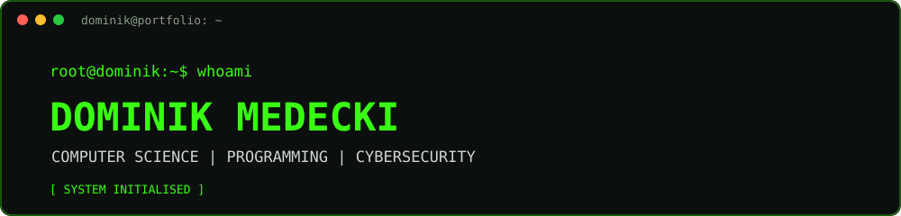
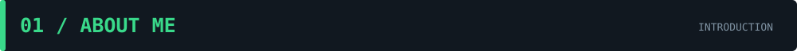
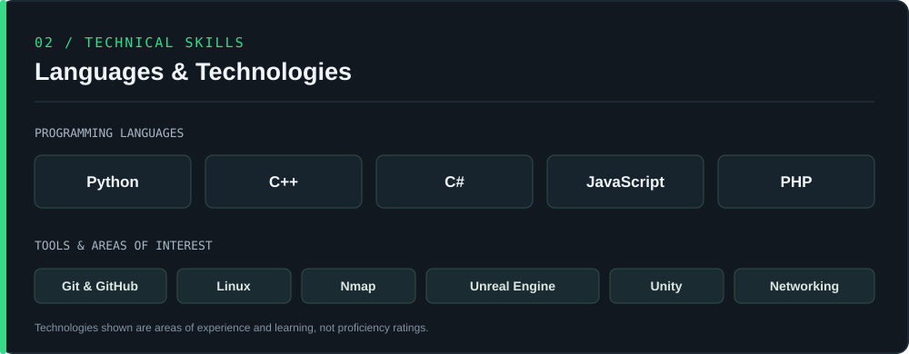

  

  
  
  

---

My name is Dominik, and I've been passionate about computer science and technology for as long as I can remember. From troubleshooting my PlayStation 2 as a child and fixing faulty cables to writing my first Python program at 15, I've always been fascinated by how things work and how to make them work better.

My journey began with studying computer science, where my first Python project was a speed-camera application designed to capture vehicle registration plates and identify drivers exceeding the speed limit. I later continued studying IT at college before pursuing a degree in Games Development, combining my interest in programming with my lifelong passion for gaming. Since then, I've worked on projects ranging from small programming experiments to larger game development projects, several of which are showcased in this portfolio.

Today, I'm working towards a career in military cybersecurity, with a particular interest in understanding vulnerabilities, exploiting systems and developing the skills needed to identify and address security weaknesses. I believe the curiosity that originally drew me towards understanding game mechanics and exploiting systems can be applied to the wider world of cybersecurity.

I enjoy programming most when faced with a problem that requires patience, logical thinking, and persistence. I often compare this to Brazilian Jiu-Jitsu: you're placed in a difficult position, and through analysing the situation, adapting and working through different steps, you find a solution. That's the same mindset I bring to programming and learning new technologies.

I'm currently focused on strengthening my Python and C++ skills, expanding my cybersecurity knowledge, and developing my own virtual home lab to gain more practical experience.

---

  

